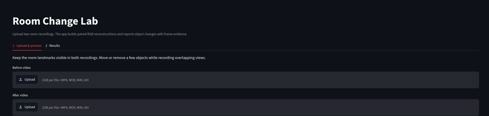
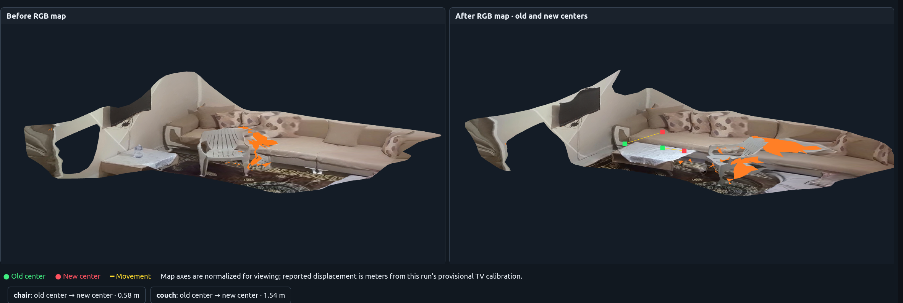
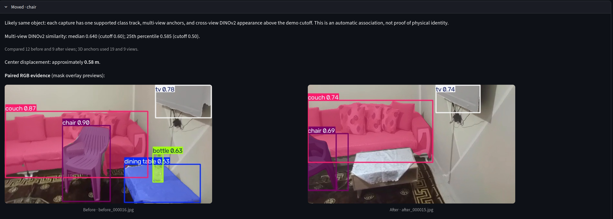
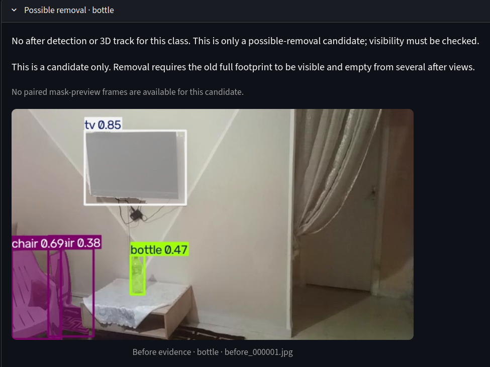

# What Changed in the Room?

An uncertainty-aware system for comparing two handheld videos of the same
indoor space. It aligns both recordings in a shared sparse map, detects objects
in RGB frames, estimates provisional 3D anchors, and presents evidence-backed
change candidates in a local web UI.

The goal is to report **what may have moved, appeared, or disappeared, where it
was observed, and how strong the evidence is**. Missing detections or sparse
points are never treated as proof that an object was removed.

## Lightweight and CPU-capable

**A GPU is optional.** The pipeline is designed to run on a regular CPU-only
computer: COLMAP uses sparse CPU reconstruction, perception uses compact model
variants, and OpenMVS builds the visual maps on CPU. This avoids a CUDA setup
and large VLM dependencies. The tradeoff is processing time: OpenMVS depth
estimation and fusion for the colored room maps is the heaviest stage. The
first run also needs internet access to download model weights.


## Quick start

### Requirements

- Linux, Python 3.10 or newer, Git, and internet access for the first model
  download
- COLMAP command-line executable available as `colmap`
- OpenMVS command-line tools: `InterfaceCOLMAP`, `DensifyPointCloud`,
  `ReconstructMesh`, `RefineMesh`, `TextureMesh`, and `Viewer`
- NVIDIA GPU is optional; the full workflow supports CPU execution, with slower
  inference and RGB map reconstruction.

COLMAP and OpenMVS are native applications, not Python packages. Install
COLMAP using your distribution or its [official installation
instructions](https://colmap.github.io/install.html). Build/install OpenMVS
using its [official instructions](https://github.com/cdcseacave/openMVS); this
project uses its CPU tools. If installed under `/usr/local/bin`, the UI default
will find them there. Otherwise, enter the directory containing the six tools
in the UI. To check the standard install location:

```bash
for tool in InterfaceCOLMAP DensifyPointCloud ReconstructMesh RefineMesh TextureMesh Viewer; do
  test -x "/usr/local/bin/$tool" || { echo "Missing OpenMVS tool: $tool"; exit 1; }
done
colmap -h >/dev/null && echo "COLMAP is available"
```

On Ubuntu or Debian, install the Python environment prerequisites with:

```bash
sudo apt update
sudo apt install -y python3 python3-venv python3-pip git
```

Install COLMAP separately with the distribution's package manager if available
or follow its official instructions above. OpenMVS is built separately; its
build depends on native libraries and can take additional time. The map stage
cannot run until all six OpenMVS tools are installed.

### Install and launch

From `navigation_humanoid/`, create an isolated environment, install the
application and launch the UI:

```bash
python3 -m venv .venv
source .venv/bin/activate
python -m pip install --upgrade pip
python -m pip install -e '.[ui,models,depth]'
python -m streamlit run src/what_changed_room/ui_app.py --server.maxUploadSize 2048
```

Open the local Streamlit URL, upload the **before** and **after** videos, and
select **Process both videos**. On the first run, Ultralytics downloads
`yolo11n-seg.pt`; DINOv2 and Depth Anything V2 Small download from Hugging Face
when used. The UI selects these models automatically and has no model-folder
controls. Downloads and inference require network access only when weights are
not already cached. Use the default `auto` device, or choose `cpu` to avoid
CUDA setup. The app saves each run to `output/ui_runs/<capture_id>/`.

### Uploading recordings

In **Upload & process**, choose the recording from before the room change in
the first upload field and the after recording in the second. Then select
**Process both videos**. Keep stable room details visible in both videos so
COLMAP can align their views.



Open the Results tab to see the automatically generated findings, evidence, and
paired RGB maps. OpenMVS generates the maps on CPU and can take several
minutes; this step requires all six OpenMVS executables above.
To open the newest generated map from a terminal:

```bash
latest_run=$(ls -dt output/ui_runs/capture_* | head -n 1)
xdg-open "$latest_run/textured_maps/paired_rgb_maps.html"
```

## Capture guidance

Record both videos in the same room with the camera moving slowly through
overlapping views. Keep stable walls and furniture in view so the recordings
can be aligned. Show changed objects clearly from multiple angles. Avoid abrupt
camera motion, blur, severe exposure changes, and hiding the entire object in
the after recording. For removal claims, show the old object footprint empty
from more than one after viewpoint.

## Results

Each completed run contains a machine-readable `automatic_candidates.json`,
logs and intermediate geometry, and an interactive
`textured_maps/paired_rgb_maps.html`. The results screen
shows candidate labels, paired RGB evidence, provisional centers, displacement,
and uncertainty.

Example paired RGB reconstructions from the Results screen:



The maps are separate textured reconstructions. On the after map, colored
markers and connecting lines show the estimated old and new centers for
candidate moved objects. Drag to rotate both maps together and scroll to zoom.

The Results screen also presents the candidate classification and the RGB
frames used as evidence. This example shows a chair movement candidate with
paired segmentation previews and an estimated center displacement:



An unmatched object is presented as a possible removal, not a confirmed one.
This example shows the before-frame detection for a bottle; the after capture
must provide sufficient visible coverage before absence can be established.



The main pipeline stages are:

1. Sample frames from each video.
2. Build a sparse COLMAP model from the before capture and localize after
   frames in the same coordinate frame.
3. Propose object masks with YOLO segmentation and link supported observations
   to provisional multiview 3D anchors.
4. Compare masked views with DINOv2 and compare the resulting anchors.
5. Estimate per-run metric scale from a known-size object when enough depth
   and registered views support calibration.
6. Build separate RGB-textured reconstructions for before and after, with
   movement centers displayed in the shared frame.

## Design choices and tradeoffs

- **Sparse shared mapping:** COLMAP provides camera poses and a common frame
  without requiring dense COLMAP reconstruction. Sparse points do not describe
  complete room surfaces.
- **Image evidence plus geometry:** object identity comes from several masked
  views; movement comes from provisional 3D anchors. A class label alone does
  not establish identity.
- **Conservative absence handling:** unmatched objects remain possible
  addition/removal candidates. Occlusion, detector misses, and missing sparse
  points cannot confirm removal.
- **RGB meshes are for communication:** OpenMVS creates the paired visual
  surfaces on CPU. These may be incomplete and are not the source of object
  positions.
- **Metric scale is per run:** monocular COLMAP scale is arbitrary. A known
  object can provide a provisional conversion; failed or inconsistent
  calibration leaves distances in map units.
- **Automatic identity is heuristic:** the current DINOv2 similarity cutoffs
  (`0.60` median and `0.50` lower quartile) are demo settings, not validated
  benchmarks. A “likely moved” result is not proof that two detections are the
  same physical object.

## Known limitations

- COLMAP localization and object anchors depend on viewpoint overlap, texture,
  mask quality, and camera calibration.
- Large camera viewpoint changes can make the same object's DINOv2 crops look
  different. Different objects from the same class can also look similar.
- The current app can miss an object or produce a false candidate. Review the
  paired source frames and map before relying on a result.
- Monocular scale and object centers are provisional; a phone video does not
  provide survey-grade measurements.
- The RGB reconstruction can be incomplete even when sparse localization
  succeeds.

## Example inputs and outputs

Video inputs, model weights, and generated runs are excluded from Git. The
recipient should upload their own before/after videos. The repository does not
currently include a shareable sample video pair or generated example result;
add a privacy-approved pair and its report/map under `examples/` before
claiming these as included examples.

## Project structure

```text
src/what_changed_room/   preprocessing, COLMAP, geometry, matching, UI
tests/                   small synthetic and unit tests
docs/                    workflow, setup, design, and stage notes
assets/                  local input videos and model files (ignored)
output/                  generated runs, maps, and databases (ignored)
```

See [docs/WORKFLOW.md](docs/WORKFLOW.md) for the pipeline schema,
[docs/ROADMAP.md](docs/ROADMAP.md) for implementation status, and
[docs/LOCAL_UI.md](docs/LOCAL_UI.md) for UI-specific details. The concise
architecture, model choices, tradeoffs, and limitations are in
[LaTeX source](docs/DESIGN_NOTE.tex) and the compiled
[design note PDF](docs/DESIGN_NOTE.pdf).

## Development

Install test and lint tools as needed, then run the small local suite:

```bash
python -m pip install -e '.[test]'
python -m pytest
```

The main CLI is available after installation as `wcr`; it also runs from the
source tree with `PYTHONPATH=src python -m what_changed_room.cli --help`.
