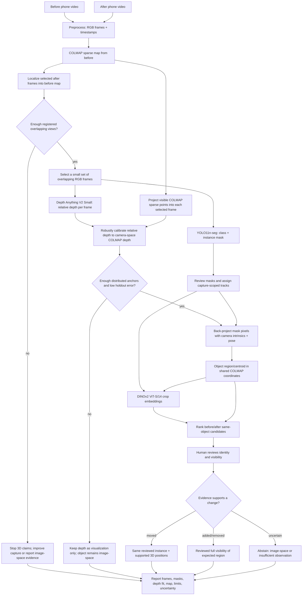

# Phone video 3D change workflow

## CPU textured reconstruction from the shared sparse map

For a room-like surface model without COLMAP dense stereo or a GPU, use the
CPU build of OpenMVS with the existing shared sparse poses. It estimates and
fuses depth maps from the RGB frames, then builds and textures a mesh. From
`navigation_humanoid/`, run:

```bash
PYTHONPATH=src ../.myenv/bin/python -m what_changed_room.cli reconstruct-openmvs-cpu \
  --shared-model output/chair_test/shared_map/shared_model \
  --before-images output/chair_test/before \
  --after-images output/chair_test/after \
  --object-report ../runs/chair_test/matches/chair_retest_candidates.json \
  --openmvs-bin .tools/openmvs-built/bin/OpenMVS \
  --output-dir ../runs/chair_test/openmvs_cpu \
  --max-threads 8
```

The command creates separate `before/` and `after/` textured models while
preserving their camera poses in the shared COLMAP frame. It also writes
`openmvs_reconstruction.json` with the reviewed chair anchors and movement in
map units, plus `openmvs.log`. Open each capture in the OpenMVS viewer (each
window shows that capture's camera poses and textured mesh):

```bash
LD_LIBRARY_PATH=.tools/openmvs-built/lib .tools/openmvs-built/bin/OpenMVS/Viewer \
  --input-file ../runs/chair_test/openmvs_cpu/before/scene_dense.mvs \
  --geometry-file ../runs/chair_test/openmvs_cpu/before/scene_textured.ply

LD_LIBRARY_PATH=.tools/openmvs-built/lib .tools/openmvs-built/bin/OpenMVS/Viewer \
  --input-file ../runs/chair_test/openmvs_cpu/after/scene_dense.mvs \
  --geometry-file ../runs/chair_test/openmvs_cpu/after/scene_textured.ply

xdg-open ../runs/chair_test/openmvs_cpu/before_after_chair_comparison.html
```

Use the browser preview for the color-coded comparison: blue is the before mesh,
orange is the after mesh, green/red markers show the reviewed chair anchors,
and yellow connects them. The preview fills the browser window; drag to rotate,
use the mouse wheel or +/− buttons to zoom, and use the checkboxes to show either
capture on its own. “Reset view” restores the initial framing. OpenMVS Viewer
does not display vertex colors on this combined comparison PLY, so use it for
the individual textured capture meshes above and use the browser for comparing
both captures together. The spheres and connector show locations only, not
chair dimensions. CPU depth estimation can take a while and may leave holes or
artifacts. The chair positions come from reviewed provisional multiview centers;
the textured mesh is for visualization, not precise object measurement. COLMAP
scale is still arbitrary.

The default model stack is intentionally small: YOLO11n-seg for object masks,
Depth Anything V2 Small for relative depth, and DINOv2 ViT-S/14 for crop
appearance matching. COLMAP supplies camera poses and a shared sparse map;
OpenCV supplies image alignment and diagnostics.

Current run status: the YOLO adapter processed all 96 frames from
`output/new_capture_run`; previews and reports are in `../runs/segment/`.
Depth Anything V2 Small produced depth maps for three selected frames, and all
three passed the sparse-anchor calibration checks. `wcr backproject-objects`
then produced provisional geometry from 21 YOLO masks (47,360 sampled points)
in `../runs/object_geometry/`. These masks and classes remain unreviewed, so
this output is for inspection and is not a confirmed change result.
`wcr rank-object-matches` adds DINOv2 crop-similarity suggestions and an HTML
review page with identity/geometry controls; the suggestions still require a
person to confirm identity. The review export feeds
`wcr compare-reviewed-matches`, which reports movement candidates only after
identity and geometry are accepted and a map-unit threshold is supplied.
The comparison consolidates repeat detections across frames into capture-scoped
tracks using matching labels and nearby COLMAP centroids (default maximum
distance 1.0 map unit), then compares track median centroids. This is a simple
baseline: the threshold is scene-scale dependent, and detections that are too
far apart or have inconsistent labels remain separate tracks.
Track geometry is additionally flagged when any member has detector confidence
below 0.40, calibration holdout p90 relative error above 10%, or inconsistent
centroids. These are screening checks, not proof that a mask is correct.
On the current run this grouped 21 masks into 15 capture-scoped tracks and
collapsed the nine positive mask-pair reviews into five reviewed object-track
associations. Three pass the confidence/calibration checks; the cup and
keyboard candidates remain insufficient because their before-mask confidence
is below 0.40. None is labeled moved because the map has no metric scale and
no movement threshold was supplied. The report and rotatable point-map preview
are `../runs/object_matches/reviewed_candidates.json` and
`../runs/object_matches/reviewed_candidates.html`; the preview includes the
provisional object points and track links. It still does not label objects
moved because COLMAP scale is arbitrary and no movement threshold was
provided.

For additions/removals, `../runs/object_matches/visibility_review_template.json`
contains unknown visibility for every provisional all-frame detector track.
Running `compare-observations` with that file produces
`../runs/object_matches/visibility_change_candidates.json`; all 112 candidates
remain `insufficient_observation` until a person confirms the opposite region
was fully visible. This is expected: after-view detections have sparse-map
registration for only 21 of 87 observations, and the detector tracks are
provisional.



## What each component answers

| Component | Question answered | Evidence it emits | Does not prove |
| --- | --- | --- | --- |
| COLMAP sparse mapping/localization | Where was this camera relative to the reference capture? | Camera pose and sparse mapped landmarks in the before-map coordinate frame | Complete room surface; metric scale; object presence/absence |
| YOLO11n-seg | Which common object classes and approximate instance masks appear in this frame? | Label, confidence, box, mask | Cross-recording physical identity or absence |
| Depth Anything V2 Small | What is the relative near/far structure in this RGB frame? | Dense relative-depth image | Meters or shared coordinates without successful per-frame calibration |
| Sparse-depth calibration | Can relative depth be related to this frame's COLMAP camera-space depths? | Fit parameters, inliers, spatial coverage, holdout residual | Reliable geometry if anchors are clustered, mismatched, or too few |
| DINOv2 ViT-S/14 | Which masked object crops look most alike? | Appearance embedding and similarity ranking | Same physical instance, motion, or semantic certainty |
| Reviewer | Is the candidate the same object, and was the opposite region actually visible? | Confirmed identity/visibility and staged ground truth | A general accuracy guarantee beyond the reviewed sample |

## Artifact flow

| Stage | Inputs | Output | Claim boundary |
| --- | --- | --- | --- |
| Preprocess | Two phone videos | Frame folders and `frame_manifest.json` | Source frames and timestamps only. |
| Shared sparse map | Before frames + COLMAP | Before database/model | Incomplete feature map with arbitrary scale. |
| Localization | After frames + reference model | Registered camera poses and shared-map preview | Only registered frames enter shared-map comparisons. |
| Detection/segmentation | Selected RGB frames | YOLO labels, masks, detections, reviewed track IDs | A miss is not proof the object is absent. |
| Relative depth | Same selected RGB frames | Float depth array and preview per frame | Relative depth only until independently calibrated. |
| Depth-to-map fit | Depth image + projected COLMAP point observations transformed to camera Z | Per-frame fit, inlier, coverage, and held-out residual diagnostics | Reject on poor anchor count, spatial spread, inlier ratio, holdout error, or non-positive camera Z. |
| Object geometry | Polygon mask + accepted depth fit + COLMAP camera model and pose | `objects.ply` and per-mask geometry summaries in `object_geometry.json` | Current YOLO proposals remain unreviewed; geometry is not a confirmed object surface or metric. |
| Cross-capture matching | Object crops + DINOv2 embeddings + 3D context | Ranked candidate associations | Similarity is a suggestion; review instance identity. |
| Change report | Reviewed identity, object geometry, visibility, frames | Candidate JSON and HTML/contact sheet | Missing sparse points or failed detections never prove removal. |

### Chair test: multiview anchor fallback

Some frames in `runs/chair_test/depth/depth_calibration.json` do not have a
reliable dense-depth fit, including the frames where the chair is clearly
visible. For a selected class such as `chair`, `backproject-objects` can also
estimate a provisional object-center anchor by intersecting mask-centroid rays
from multiple registered COLMAP views:

```sh
PYTHONPATH=src python -m what_changed_room.cli backproject-objects \
  ../runs/chair_test/annotations.json \
  --depth-report ../runs/chair_test/depth/depth_calibration.json \
  --shared-model output/chair_test/shared_map/shared_model \
  --before-images output/chair_test/before \
  --after-images output/chair_test/after \
  --output-dir ../runs/chair_test/geometry \
  --triangulate-label chair
```

This fallback does not accept rejected depth fits or create dense object
surfaces. It requires repeated, registered detections, sufficient view angle,
and low ray residuals; its center remains provisional because a 2D mask center
is not a persistent physical point on the object. The result is in arbitrary
COLMAP map units. Review the mask crops and the before/after anchor geometry
before treating displacement as a change. If the repeated detections do not
form a consistent ray intersection, the object stays without this 3D anchor.

## Optional escalation models

SAM2.1 Tiny can refine a prompted mask and propagate it within one video if
YOLO masks are inadequate. LightGlue can be tried if conventional image
matching fails. OpenCLIP or Grounding DINO are only justified if text-prompted
open-vocabulary categories are required. These are not required dependencies
for the first GPU run; see [model choices and the one-day plan](MODEL_RESEARCH_AND_1DAY_PLAN.md)
for sizes, licensing, and escalation criteria.

### Review whether a moved object's old location is visible

For the chair test, generate an after-frame gallery that overlays the old
COLMAP-space center (red) and the current chair detections (green). It copies
the images into the output folder, so the HTML can be opened directly. The
projected center is only a visual cue; review whether the *entire old chair
footprint* is visible and empty in each frame. This command does not declare
an object removed automatically.

From `navigation_humanoid/`:

```sh
PYTHONPATH=src ../.myenv/bin/python -m what_changed_room.cli review-old-location \
  ../runs/chair_test/matches/chair_retest_candidates.json \
  ../runs/chair_test/annotations.json \
  --shared-model output/chair_test/shared_map/shared_model \
  --after-images output/chair_test/after \
  --output-dir ../runs/chair_test/visibility_evidence
xdg-open ../runs/chair_test/visibility_evidence/visibility_evidence.html
```

In the gallery, choose a visibility decision for each frame and click
**Download reviewed decisions**. The browser downloads `visibility_review.json`;
keep it with the run artifacts. The current chair pair already has a reviewed
same-object match across recordings, so the supported result is **moved**.
Do not describe it as removed. The report intentionally leaves full-footprint
visibility unknown until those frame decisions are reviewed.
